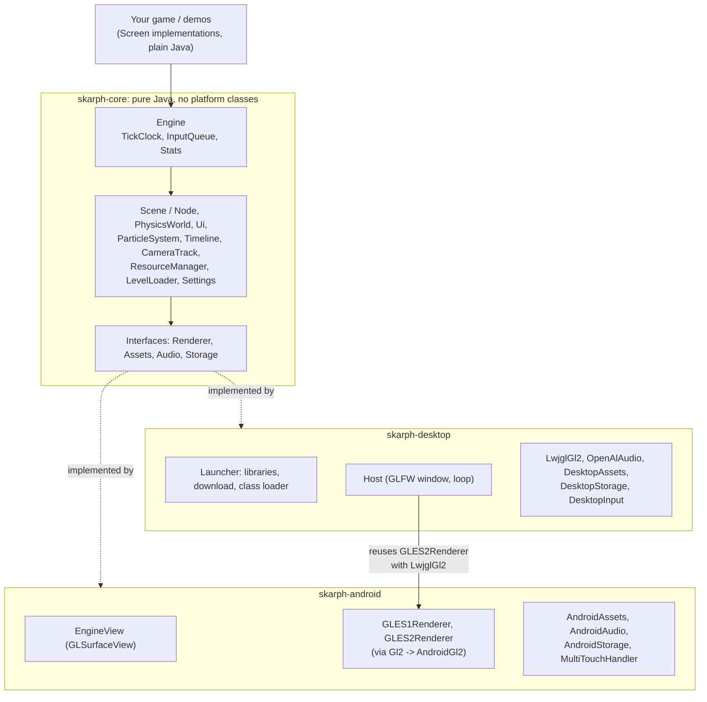
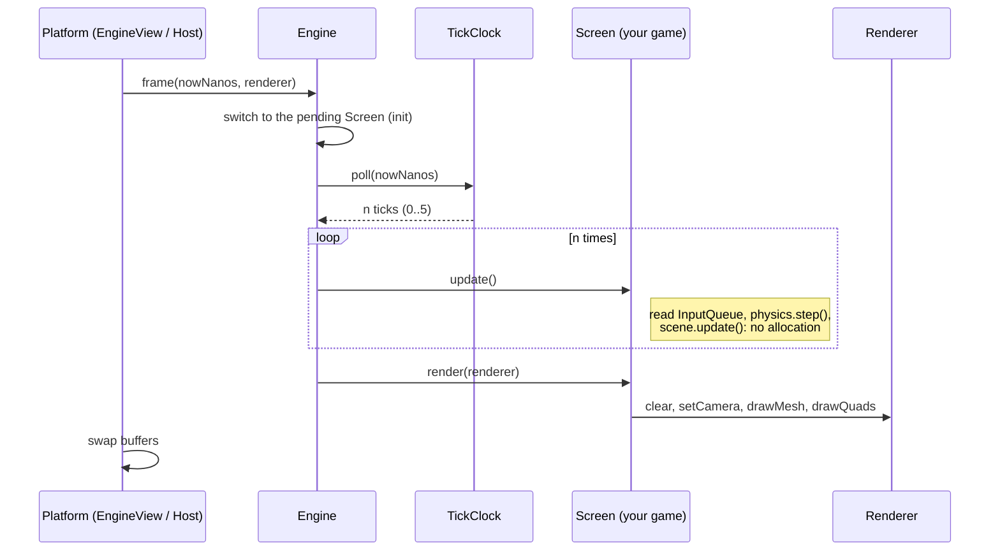
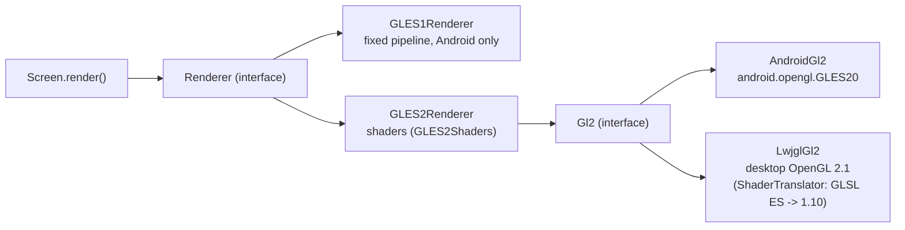
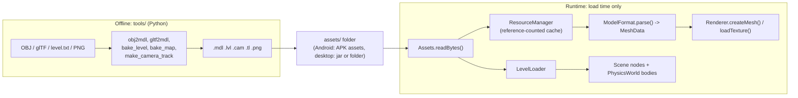
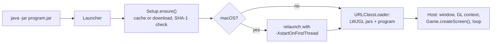

# Architecture

A one-page map of Skarph. Details of every class are in [MANUAL.md](MANUAL.md) and [API.md](API.md); this page
only shows how the parts fit together and which rules hold everywhere.

## 1. Layers

The core is pure Java and knows no platform. It talks to the outside world only through small interfaces
(`Renderer`, `Assets`, `Audio`, `Storage`, `Log`). Each platform layer implements them.

Rules of the layers:

- `skarph-core` never imports `android.*`, `org.lwjgl.*` or `java.awt.*`. A game written against the core runs on both platforms.
- The platform layers do not depend on each other, except that the desktop window reuses `GLES2Renderer` (it is pure Java on top of the `Gl2` interface) with its own `LwjglGl2`.
- Everything the core needs from the platform is handed in by the platform layer: `engine.setAssets()`, `setAudio()`, `setStorage()`.

## 2. One frame

The platform calls `Engine.frame()` once per rendered frame, always on the render thread. Logic runs on a fixed 60 Hz
clock with no delta time; slow frames run several ticks, fast frames run none.

Input arrives on the platform's own thread and is pushed into the `InputQueue` (a lock-protected ring buffer);
`update()` drains it. On desktop the window and the loop run on the main thread (GLFW requires it); on Android the
GL thread of `GLSurfaceView` is the render thread.

## 3. Rendering backends

Screens draw through the `Renderer` interface and refer to meshes and textures by `int` handles. Handles survive a
lost GL context: the renderer recreates the GPU resources itself.

- Android picks the backend at start (`EngineView.BACKEND_AUTO`): ES 2.0 when the device is Android 2.3+ and reports ES 2.0, otherwise ES 1.x. If the ES 2.0 shaders fail on a driver, `BackendListener` lets the app restart with ES 1.x.
- Desktop always uses the ES 2.0 renderer.
- Meshes are drawn lit by one directional light plus ambient, or with a baked lightmap; fog is applied last.

## 4. Content pipeline

Assets are produced offline by the Python tools and read at load time. Loading allocates; the game loop never loads.

## 5. Desktop start-up

The portable jar starts without LWJGL on its class path. `Launcher` prepares the libraries first, so no LWJGL class is
touched before they exist.

## 6. Rules that hold everywhere

| Rule | What it means in practice |
|---|---|
| Fixed 60 Hz, no delta time | All time is counted in ticks. Velocity is units per tick. Logic is repeatable. |
| No allocation in the loop | `update()` and `render()` never use `new`. Memory is allocated in `Screen.init()` or at load time. |
| Fixed capacities | `Scene`, `PhysicsWorld`, `Pool`, `ParticleSystem` and the tables of `ResourceManager` are sized once. When one is full, `create...()` returns `null` or `-1`; nothing grows. |
| Handles, not references | Meshes and textures are `int` handles into the renderer. |
| Core is platform free | Platform features come in through interfaces and are `null`-safe (`NullAudio`, `MemoryStorage`). |
| Old devices count | The core and the Android layer compile against API 3 (Android 1.5), the core and desktop against Java 8. `build.sh` checks both. |
| Diagnostics are built in | `Profiler`, `Stats`, `Benchmark` and `QualityGovernor` show FPS, draw calls and GC count; a healthy game shows `GC 0`. |

## 7. Where to look

| You want to... | Start here |
|---|---|
| Write a game | `Screen`, `Engine`, MANUAL section 2 |
| Change drawing | `Renderer`, then `GLES2Renderer` / `GLES1Renderer`, `GLES2Shaders` |
| Add a platform feature | the interface in `skarph-core`, then both platform layers |
| Add an asset type | `tools/` converter, a parser in `skarph-core`, `ResourceManager` |
| Understand the desktop jar | `Launcher`, `Setup`, `Host` (MANUAL section 14) |
| Check what is tested | `tests/`, run by `build.sh` (MANUAL section 12) |
